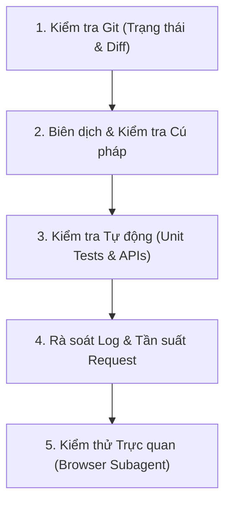

# Robotics UI Quality Assurance & Regression Testing Workflow

Skill này chuẩn hóa quy trình kiểm thử toàn diện trước khi bàn giao bất kỳ thay đổi nào trong dự án Airport Guide Robot.

## 1. Quy trình Kiểm thử 5 Bước



---

### Bước 1: Kiểm tra Trạng thái Git
Luôn kiểm tra các file đang sửa đổi và bảo đảm không vô tình thay đổi file ngoài phạm vi:
```bash
git status --short
git diff --stat
```
> [!IMPORTANT]
> Không chạy `git reset --hard`, `git checkout .`, `git commit` hoặc `git push` trừ khi có chỉ thị trực tiếp từ người dùng.

---

### Bước 2: Kiểm tra Cú pháp & Biên dịch

#### Kiểm tra cú pháp Python tầng Backend:
```bash
docker exec airport_guide_backend python3 -c "
import py_compile
for p in ['/app/app/adapters/ros_adapter.py', '/app/app/api/robot_router.py', '/app/app/ws/broadcaster.py', '/app/app/adapters/base.py', '/app/app/adapters/mock_adapter.py']:
    py_compile.compile(p, cfile='/tmp/test.pyc', doraise=True)
print('ALL BACKEND PYTHON FILES COMPILE CLEANLY')
"
```

#### Biên dịch bản build Frontend TypeScript:
```bash
docker compose build frontend
```

---

### Bước 3: Kiểm tra API & Unit Tests

#### Chạy pytest tự động trong container:
```bash
docker exec airport_guide_backend bash -c "export PYTHONPATH=/app ROBOT_ADAPTER_MODE=mock && pytest -o cache_dir=/tmp/.pytest_cache /app/tests"
```

#### Kiểm tra các Endpoint REST API:
```bash
# 1. Health check
curl -s http://localhost:5173/api/health | jq .

# 2. Map Metadata check
curl -s http://localhost:5173/api/robot/map | jq .

# 3. Map Image check
curl -s -D - "http://localhost:5173/api/robot/map/image?v=<version_id>" -o /dev/null | grep -E "HTTP/|Content-Type|Cache-Control"
```

---

### Bước 4: Rà soát Log & Tần suất Request (Chống Spam)
Đảm bảo Nginx và Backend không bị quá tải bởi các yêu cầu lặp vô hạn từ client:
```bash
# Kiểm tra log Nginx: map/image chỉ xuất hiện 1 lần cho mỗi phiên mở trang
docker compose logs --tail=30 frontend | grep "map/image"

# Kiểm tra log lỗi Backend nếu có
docker compose logs --tail=50 backend | grep -iE "error|exception|traceback"
```

---

### Bước 5: Kiểm thử Trực quan (Visual Validation)
Sử dụng Antigravity `browser` subagent với Model `flash` để kiểm tra giao diện trực tiếp:
1. Mở `http://localhost:5173/` (Trang Hành khách):
   * Xác nhận ảnh bản đồ phòng đa giác và chướng ngại vật hiển thị rõ nét trong SVG.
   * Xác nhận marker robot (vòng tròn xanh + mũi tên cam) hiển thị đúng vị trí và hướng xoay.
   * Chụp ảnh màn hình lưu vết.
2. Mở `http://localhost:5173/admin` (Trang Quản trị):
   * Đăng nhập vai trò Admin (`admin` / `admin123`).
   * Kiểm tra bản đồ và bảng Telemetry hiển thị đồng bộ tọa độ (X, Y, theta).
   * Chụp ảnh màn hình lưu vết.
