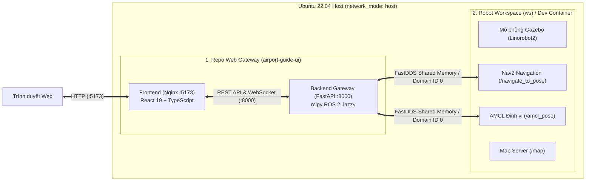

# ✈️ Airport Guide Robot — Giao Diện Web & Gateway ROS 2

Ứng dụng web Full-stack điều khiển và giám sát robot dẫn đường sân bay, kết nối trực tiếp với hệ điều hành robot **ROS 2 Jazzy** (Nav2, AMCL, Gazebo) thông qua kiến trúc Gateway hiệu năng cao.

---

## 📖 MỤC LỤC
1. [Giới Thiệu Dự Án](#1-giới-thiệu-dự-án)
2. [Yêu Cầu Hệ Thống & Chuẩn Bị Môi Trường](#2-yêu-cầu-hệ-thống--chuẩn-bị-môi-trường)
3. [Kiến Trúc Hai Thành Phần Độc Lập](#3-kiến-trúc-hai-thành-phần-độc-lập)
4. [Hướng Dẫn Cài Đặt & Khởi Chạy Lần Đầu](#4-hướng-dẫn-cài-đặt--khởi-chạy-lần-đầu)
5. [Kiểm Tra Kết Nối 3 Tầng, Đăng Nhập & Truy Cập LAN](#5-kiểm-tra-kết-nối-3-tầng--đăng-nhập)
6. [Hướng Dẫn Thao Tác Trên Giao Diện](#6-hướng-dẫn-thao-tác-trên-giao-diện)
7. [Quản Lý Dữ Liệu Điểm Đến & Ảnh Sơ Đồ](#7-quản-lý-dữ-liệu-điểm-đến--ảnh-sơ-đồ)
8. [Vận Hành Thường Nhật & Tài Liệu Tham Khảo](#8-vận-hành-thường-nhật--tài-liệu-tham-khảo)

---

## 1. GIỚI THIỆU DỰ ÁN

Hệ thống cung cấp giao diện điều khiển robot dẫn đường sân bay dành cho hai đối tượng người dùng:

- **Hành khách (Passenger — Không cần đăng nhập):**
  - Truy cập trực tiếp tại trang chủ: `http://localhost:5173`.
  - Xem sơ đồ tầng sân bay, chọn điểm đến mong muốn (Cổng khởi hành, Quầy check-in, Khu vệ sinh, v.v.).
  - Bấm **[ Bắt Đầu Dẫn Đường ]** để robot dẫn đường đi trước.
  - Theo dõi trực quan vị trí và đường đi của robot theo thời gian thực.
  - Tương tác với trợ lý giọng nói robot (Voice Assistant) và hủy chuyến đi của chính mình khi cần.

- **Quản trị viên / Kỹ sư vận hành (Admin — Đăng nhập tài khoản):**
  - Truy cập tại trang quản trị: `http://localhost:5173/admin`.
  - Giám sát đồng thời hai chế độ hiển thị bản đồ: **Bản đồ ROS** (OccupancyGrid thực tế từ cảm biến) và **Sơ đồ hành khách** (ảnh thiết kế trực quan).
  - **Chọn tọa độ trực tiếp trên bản đồ:** Bật chế độ chấm điểm, click chuột trực tiếp lên vùng sàn trống trên bản đồ ROS để tự động điền tọa độ X, Y và lưu điểm mới.
  - Quản lý danh sách điểm đến lưu bền vững (Thêm, Sửa, Xóa điểm đến có xác nhận).
  - Điều khiển toàn diện hành trình: **Bắt đầu**, **Tạm dừng**, **Tiếp tục**, và **Hủy** chuyến dẫn đường.
  - Giám sát trạng thái điều khiển (AUTO / MANUAL), điều khiển vận tốc thủ công, xem cảnh báo hệ thống từ các ROS nodes (`/airport/alerts`).

---

## 2. YÊU CẦU HỆ THỐNG & CHUẨN BỊ MÔI TRƯỜNG

### 2.1. Yêu cầu hệ điều hành
- **Khuyến nghị:** Ubuntu 22.04 LTS (x86_64).
- Toàn bộ giao diện Web và Backend Gateway đã được đóng gói khép kín trong Docker containers với `network_mode: host`. **Không cần cài đặt `npm`, `node`, `pip` hay `python-venv` lên hệ điều hành Ubuntu host.**

### 2.2. Kiểm tra các công cụ nền tảng cần có
Mở terminal trên máy Ubuntu host và kiểm tra các lệnh sau:

```bash
# 1. Kiểm tra Git (yêu cầu >= 2.34)
git --version

# 2. Kiểm tra Docker Engine (yêu cầu >= 24.0)
docker --version

# 3. Kiểm tra Docker Compose V2 (yêu cầu >= 2.20)
docker compose version

# 4. Kiểm tra quyền chạy Docker không cần sudo
docker ps
```
> [!TIP]
> Nếu lệnh `docker ps` báo lỗi quyền truy cập (`permission denied`), hãy thêm người dùng hiện tại vào nhóm docker bằng lệnh: `sudo usermod -aG docker $USER` rồi đăng xuất và đăng nhập lại hệ điều hành.

---

## 3. KIẾN TRÚC HAI THÀNH PHẦN ĐỘC LẬP

Hệ thống tổng thể gồm hai phần hoàn toàn tách biệt:



1. **Repo Web Gateway (`airport-guide-ui`):**
   - Chứa mã nguồn giao diện React, Backend FastAPI, tệp Docker Compose và cấu hình kết nối.
   - Khi clone repo này về, bạn **đã có sẵn 100%** mã nguồn web, bộ kiểm thử tự động và dữ liệu khởi tạo.
2. **Workspace Robot / Mô phỏng (`ws`):**
   - Chứa các package ROS 2 của robot hoặc mô phỏng Gazebo (Linorobot2, Nav2, AMCL).
   - Thường được mở trong VS Code Dev Container (ví dụ container `thirsty_ishizaka`) trên nền **ROS 2 Jazzy**.
   - Hai bên giao tiếp với nhau hoàn toàn qua chuẩn FastDDS Shared Memory với **ROS Domain ID 0**.

> [!IMPORTANT]
> **Quy tắc phân biệt phiên bản ROS:**
> Nếu Ubuntu host của bạn đang cài đặt ROS 2 Humble, **tuyệt đối không dùng lệnh ROS trên host** để kiểm tra hệ thống Jazzy. Mọi lệnh kiểm tra ROS Jazzy phải thực thi qua `docker compose exec backend bash -c "..."` hoặc trong Dev Container.

### 🌟 Lựa chọn chế độ Mock (Xem thử UI khi chưa có Gazebo / ROS)
Nếu bạn chưa có sẵn workspace mô phỏng Gazebo hoặc muốn chạy thử nghiệm giao diện trên Windows/macOS/Linux:
- Hệ thống hỗ trợ chế độ **`ROBOT_ADAPTER_MODE=mock`**.
- Backend sẽ tự động phát sinh vị trí robot ảo, tải bản đồ demo và cho phép trải nghiệm toàn bộ tính năng web (chọn điểm, lưu điểm đến, mô phỏng chuyển động).
- *Lưu ý:* Dữ liệu mô phỏng vật lý 3D của Gazebo/Nav2 hoàn toàn khác biệt với chế độ Mock toán học của web.

---

## 4. HƯỚNG DẪN CÀI ĐẶT & KHỞI CHẠY LẦN ĐẦU

### Bước 4.1: Clone repo và vào thư mục dự án
```bash
# Clone mã nguồn dự án
git clone https://github.com/thuytran/airport-guide-ui.git

# Di chuyển vào thư mục dự án
cd airport-guide-ui
```

### Bước 4.2: Chuẩn bị tệp cấu hình và dữ liệu
Repo đã quản lý sẵn các tệp cấu hình chính. Bạn chỉ cần chuẩn bị khóa bí mật và thư mục dữ liệu:

1. **Tạo tệp `.env` chứa khóa bảo mật JWT:**
   ```bash
   echo "SECRET_KEY=demo_airport_robot_secret_key_2026_change_in_production" > .env
   ```
2. **Khởi tạo thư mục dữ liệu lưu trữ bền vững:**
   ```bash
   mkdir -p data
   [ -f data/destinations.yaml ] || cp config/destinations.yaml data/destinations.yaml
   ```

### Bước 4.3: Thứ tự khởi động hệ thống

#### 👉 Lựa chọn A: Chạy kết hợp với Gazebo & Nav2 (Đầy đủ)
1. **Khởi động mô phỏng trước trong Dev Container ROS 2 (`ws`):**
   - Mở terminal trong Dev Container (`thirsty_ishizaka`) và chạy:
     ```bash
     # Terminal 1: Khởi động mô phỏng Gazebo
     ros2 launch linorobot2_gazebo gazebo.launch.py

     # Terminal 2: Khởi động hệ thống điều hướng Nav2 & AMCL
     ros2 launch linorobot2_navigation navigation.launch.py sim:=true
     ```
2. **Khởi động Web Gateway trên Terminal Ubuntu Host:**
   ```bash
   cd ~/airport-guide-ui
   docker compose up -d --build
   ```

#### 👉 Lựa chọn B: Chạy chế độ Mock độc lập (Không cần ROS)
1. Mở file `.env` và thêm cấu hình:
   ```bash
   echo "ROBOT_ADAPTER_MODE=mock" >> .env
   ```
2. Khởi động Web Gateway:
   ```bash
   docker compose up -d --build
   ```

---

## 5. KIỂM TRA KẾT NỐI 3 TẦNG & ĐĂNG NHẬP

### Bước 5.1: Kiểm tra trạng thái container
```bash
docker compose ps
```
Cả hai container `airport_guide_backend` và `airport_guide_frontend` phải ở trạng thái `Up`.

### Bước 5.2: Kiểm tra sức khỏe API Gateway
Chạy lệnh kiểm tra endpoint sức khỏe:
```bash
curl -s http://localhost:8000/api/health | jq .
```
Kết quả trả về chuẩn:
```json
{
  "status": "healthy",
  "app_name": "Airport Guide Robot Backend",
  "adapter_mode": "ros",
  "ros_domain_id": 0,
  "robot_connected": true,
  "map_available": true
}
```

> [!WARNING]
> **Quy tắc đọc kết quả:**
> - HTTP 200 và `"status": "healthy"`: Web Gateway đang chạy tốt.
> - `"robot_connected": true`: Backend đã bắt được tín hiệu tọa độ từ AMCL (`/amcl_pose`). Nếu là `false`, mô phỏng Gazebo/AMCL chưa phát hoặc bị lệch Domain ID.
> - `"map_available": true`: Backend đã nhận được bản đồ OccupancyGrid từ `/map`.

### Bước 5.3: Truy cập ứng dụng trên trình duyệt
- **Màn hình Hành khách:** Mở trình duyệt tại `http://localhost:5173`.
- **Màn hình Quản trị viên:** Mở `http://localhost:5173/admin`.
  - **Tài khoản mặc định:** `admin`
  - **Mật khẩu mặc định:** `admin123`

### Bước 5.4: Truy cập từ Laptop thứ hai trong cùng mạng LAN (Multi-machine Access)

Hệ thống được thiết kế theo kiến trúc **Same-Origin Reverse Proxy**, cho phép bất kỳ laptop, máy tính bảng hoặc điện thoại nào trong cùng mạng Wi-Fi/LAN truy cập và điều khiển robot mà **hoàn toàn không cần cài đặt ROS 2, Docker hay Node.js** trên thiết bị đó.

#### 1. Lấy địa chỉ IP mạng LAN của máy chủ ThinkPad
Trên máy chủ ThinkPad (nơi chạy Docker/Gazebo), mở terminal và chạy:
```bash
hostname -I
```
> Kết quả thường hiển thị danh sách IP (ví dụ: `192.168.0.108 172.17.0.1`). Hãy chọn địa chỉ IP thuộc mạng Wi-Fi/LAN gia đình hoặc văn phòng (thường bắt đầu bằng `192.168.x.x` hoặc `10.x.x.x`, bỏ qua dải `172.17.x.x` của Docker bridge).

#### 2. Mở trình duyệt trên Laptop thứ hai
Trên laptop thứ hai (Windows, macOS hoặc Linux), mở trình duyệt web hiện đại (Google Chrome, Microsoft Edge, Mozilla Firefox hoặc Safari) và truy cập:
- **Màn hình Hành khách:** `http://<IP_THINKPAD>:5173` (ví dụ: `http://192.168.0.108:5173`)
- **Màn hình Quản trị viên:** `http://<IP_THINKPAD>:5173/admin`
  - Tài khoản: `admin`
  - Mật khẩu: `admin123`

#### 3. Nguyên lý hoạt động & Tính bảo đảm mạng
- **Không lỗi CORS:** Nginx chạy tại cổng `5173` tiếp nhận toàn bộ truy vấn của trình duyệt khách, đồng thời proxy ngược các route `/api/` và kết nối WebSocket `/ws` về backend FastAPI nội bộ (`127.0.0.1:8000`). Trình duyệt chỉ giao tiếp với một Origin duy nhất (`http://<IP_THINKPAD>:5173`), hoàn toàn không bị chặn CORS hay lỗi Security Mixed Content.
- **WebSocket tự động nhận diện Host:** Bộ kết nối `wsClient.ts` tự động phát hiện `window.location.host` để mở kết nối `ws://<IP_THINKPAD>:5173/ws`, bảo đảm cập nhật tọa độ robot real-time 5Hz đồng bộ trên mọi thiết bị kết nối.
- **Tường lửa (UFW Firewall):** Nếu laptop thứ hai không tải được trang, hãy kiểm tra tường lửa trên máy chủ ThinkPad bằng lệnh `sudo ufw status`. Nếu UFW đang hoạt động (`active`), hãy mở cổng 5173 bằng lệnh:
  ```bash
  sudo ufw allow 5173/tcp
  ```

---

## 6. HƯỚNG DẪN THAO TÁC TRÊN GIAO DIỆN

### 6.1. Quản lý điểm đến trên bản đồ (Dành cho Admin)
1. Đăng nhập trang Admin: `http://localhost:5173/admin`.
2. Chuyển sang tab **"Bản đồ ROS"**.
3. Bấm nút **[ 📍 Chọn tọa độ trên bản đồ ]** (nút chuyển sang trạng thái đang chờ click).
4. Click chuột vào một vị trí sàn trống mong muốn trên bản đồ ➔ Tọa độ X, Y tự động được điền chính xác vào form.
5. Nhập ID và Tên điểm đến (ví dụ: `Gate 10`, `Cửa khởi hành số 10`), sau đó bấm **[ 💾 Lưu Điểm Đến (Lưu Bền Vững) ]**.
6. Điểm đến mới ngay lập tức xuất hiện trên danh sách của cả Admin và màn hình Hành khách.
7. **Xóa điểm đến:** Bấm nút **"Xóa"** bên cạnh điểm muốn gỡ bỏ trong danh sách, xác nhận tên điểm đến trên hộp thoại modal.

### 6.2. Kịch bản nghiệm thu dẫn đường trên Gazebo
Toàn bộ quy trình kiểm tra thực tế các kịch bản:
- **Kịch bản A:** Bắt đầu (Start) ➔ Tạm dừng (Pause) ➔ Tiếp tục (Resume) ➔ Về đích (Succeeded).
- **Kịch bản B:** Bắt đầu (Start) ➔ Tạm dừng (Pause) ➔ Hủy chuyến (Cancel) ➔ Bắt đầu chuyến mới.

Được ghi nhận chi tiết từng bước tại:  
👉 [`docs/PHASE_C_HANDOVER.md` — Mục 8: Hướng dẫn nghiệm thu thực tế trên Gazebo](docs/PHASE_C_HANDOVER.md#8-hướng-dẫn-nghiệm-thu-thực-tế-trên-gazebo-manual-test-scripts)

---

## 7. QUẢN LÝ DỮ LIỆU ĐIỂM ĐẾN & ẢNH SƠ ĐỒ

### 7.1. Phân biệt Seed File (`config/`) và Storage File (`data/`)
- **Tệp khởi tạo `config/destinations.yaml`:** Là dữ liệu mẫu nguyên bản, được mount vào container ở chế độ **chỉ đọc (`:ro`)**.
- **Tệp lưu trữ bền vững `data/destinations.yaml`:** Là tệp hoạt động thực tế (runtime), được mount chế độ **đọc/ghi (`rw`)**. Mọi thao tác Thêm, Sửa, Xóa từ Admin đều ghi trực tiếp vào tệp này thông qua cơ chế ghi an toàn nguyên tử (atomic write).
- **Cơ chế an toàn:** Nếu Quản trị viên xóa toàn bộ điểm đến khiến tệp lưu trữ thành `destinations: []`, hệ thống vẫn nạp chính xác danh sách rỗng đó, **tuyệt đối không tự động nạp lại seed file**.

### 7.2. Sao lưu và khôi phục dữ liệu
```bash
# Sao lưu dữ liệu hiện tại:
cp data/destinations.yaml data/destinations_backup_$(date +%Y%m%d).yaml

# Đặt lại (Reset) danh sách điểm về cấu hình xuất xưởng ban đầu:
cp config/destinations.yaml data/destinations.yaml
docker compose restart backend
```

### 7.3. Cập nhật ảnh Sơ đồ hành khách (Passenger Map)
- Đường dẫn tệp ảnh: [frontend/public/maps/passenger_map.png](file:///home/thuytran/airport-guide-ui/frontend/public/maps/passenger_map.png).
- **Yêu cầu kỹ thuật:** Ảnh sơ đồ phải có cùng tỷ lệ khung hình và độ phân giải khớp với bản đồ OccupancyGrid thực tế (mặc định mô phỏng là `384x384` pixel) để phép chiếu tọa độ của xe và điểm đến khớp hoàn hảo.
- Sau khi thay file ảnh mới, chạy lệnh cập nhật:
  ```bash
  docker compose build frontend && docker compose up -d frontend
  ```

---

## 8. VẬN HÀNH THƯỜNG NHẬT & TÀI LIỆU THAM KHẢO

### 8.1. Các lệnh thường dùng hàng ngày
```bash
# Bật lại hệ thống sau khi mở máy:
cd ~/airport-guide-ui && docker compose up -d

# Tắt hệ thống an toàn:
docker compose down

# Xem log Backend khi cần gỡ lỗi:
docker compose logs -f backend

# Chạy toàn bộ 19 bài kiểm thử tự động pytest:
docker compose exec backend bash -c "source /opt/ros/jazzy/setup.bash && export PYTHONPATH=/app ROBOT_ADAPTER_MODE=mock && pytest -v -o cache_dir=/tmp/.pytest_cache /app/tests"
```

### 8.2. Cẩm nang tra cứu lệnh & Xử lý sự cố chi tiết
Để tra cứu đầy đủ các câu lệnh chẩn đoán DDS, kiểm tra topic ROS 2, phân biệt `restart` / `rebuild` / `recreate`, và xử lý các sự cố như 502 Bad Gateway, robot disconnected hay mất map:  
👉 **Xem cẩm nang tra cứu tập trung tại:** [`docs/COMMANDS_CHEATSHEET.md`](docs/COMMANDS_CHEATSHEET.md)

### 8.3. Danh mục tài liệu kỹ thuật liên quan
- **Biên bản bàn giao Giai đoạn C:** [`docs/PHASE_C_HANDOVER.md`](docs/PHASE_C_HANDOVER.md)
- **Cẩm nang cấu hình ROS 2 Gateway:** [`docs/ROS_CONFIGURATION_GUIDE.md`](docs/ROS_CONFIGURATION_GUIDE.md)
- **Hướng dẫn phát triển đa nền tảng:** [`docs/cross-platform-guide.md`](docs/cross-platform-guide.md)
- **Ràng buộc nghiệp vụ AI Agent:** [`AGENTS.md`](AGENTS.md)
