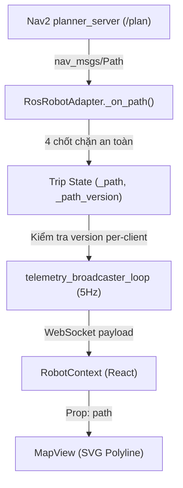
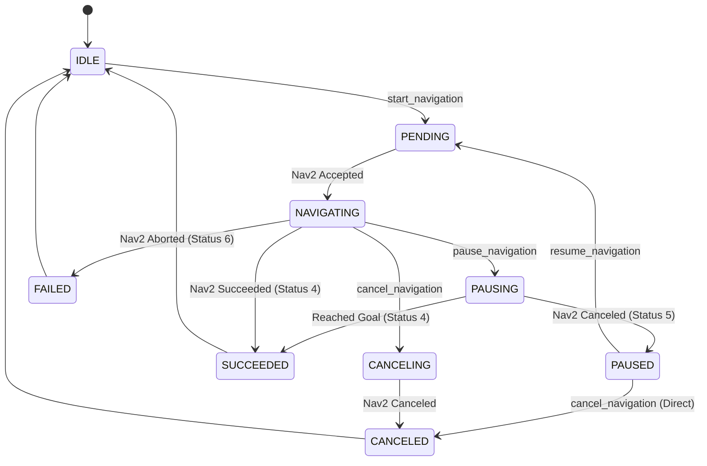

# Biên Bản Bàn Giao Triển Khai & Kiểm Thử Toàn Diện Giai Đoạn C (Part 1, Part 2, Part 3, Part 4 & Part 5: Pause & Resume)
**Dự án:** Airport Guide Robot UI (`airport-guide-ui`)  
**Môi trường:** ROS 2 Jazzy (Docker, Domain ID 0, Sim Time = True)  
**Thời gian cập nhật:** 14/11/2026  
**Trạng thái nghiệm thu:** **19 / 19 Pytest PASSED (100%)**, Frontend & Backend Docker Rebuilt, Persistent Storage & Deletion Verified, **Pause & Resume Navigation Architecture Completed & Verified**.

---

## 1. PHẦN 1 — ADMIN CHỌN ĐIỂM ĐẾN TRÊN BẢN ĐỒ ROS & CẤU HÌNH YAML

### 1.1. Chế Độ "Chọn Tọa Độ Trên Bản Đồ" (Coordinate Picker Mode)
- **Cơ chế hoạt động:**
  - Nút **[ 📍 Chọn tọa độ trên bản đồ ]** được tích hợp ngay dưới form "Thêm / Cập Nhật Điểm Đến" trên trang Admin.
  - Khi bấm kích hoạt:
    - Nếu đang ở tab "Sơ đồ hành khách", hệ thống tự động chuyển sang tab **"Bản đồ ROS"** (nơi có metadata OccupancyGrid chuẩn xác).
    - Banner hướng dẫn xuất hiện trên bản đồ: *"🎯 Nhấp vào một điểm trên Bản đồ ROS để lấy tọa độ X, Y"*.
    - Nút chuyển trạng thái thành **[ ✖ Hủy chọn tọa độ ]** để người vận hành có thể thoát chế độ bất cứ lúc nào.
- **Phép chiếu ngược tọa độ (`projectMapPixelToRos`):**
  - Thực hiện nghịch đảo ma trận xoay $R^{-1}(\theta)$ và chuyển đổi hệ tọa độ SVG viewBox sang hệ tọa độ metric của ROS frame `map`:
    $$\begin{aligned}
    u &= \text{px} \times \text{resolution} \\
    v &= (\text{height} - \text{py}) \times \text{resolution} \\
    \Delta x &= \cos(a) \times u - \sin(a) \times v \\
    \Delta y &= \sin(a) \times u + \cos(a) \times v \\
    \text{rosX} &= \text{origin\_x} + \Delta x \\
    \text{rosY} &= \text{origin\_y} + \Delta y
    \end{aligned}$$
  - Tự động bù trừ chính xác các tham số: `pan`, `zoom`, kích thước viewBox, `origin_x`, `origin_y`, `origin_yaw` ($a$), và `resolution`.
- **Chống kích hoạt nhầm (Anti-False-Triggering):**
  - **Lọc thao tác kéo chuột (Drag):** Tính khoảng cách di chuyển chuột $d = \sqrt{\Delta x^2 + \Delta y^2}$. Nếu $d > 5\text{px}$, hệ thống coi đó là thao tác kéo pan bản đồ và **không** ghi nhận chọn điểm.
  - **Lọc nút bấm HUD:** Các nút điều khiển zoom (+, -, reset) được gắn `stopPropagation` để ngăn sự kiện click lan truyền vào bản đồ.
  - **Kiểm tra biên ảnh:** Tọa độ click phải nằm hoàn toàn trong phạm vi $[0, \text{width}] \times [0, \text{height}]$.
  - **Chỉ kích hoạt khi có metadata ROS:** Nút chọn bị vô hiệu hóa nếu chưa nhận được bản đồ OccupancyGrid hợp lệ từ backend.

---

### 1.2. Preview Pin (Điểm Nháp Xem Trước)
- **Hiển thị trực quan:**
  - Điểm nháp xuất hiện ngay lập tức trên bản đồ ROS tại tọa độ Admin click hoặc nhập tay vào form.
  - Thiết kế đồ họa:
    - Vòng hào quang đứt nét màu hổ phách (`#F59E0B`) tạo điểm nhấn.
    - Điểm trung tâm màu cam hổ phách có viền trắng.
    - Nhãn **"Điểm nháp"** nổi bật phía trên pin.
    - Mũi tên chỉ hướng xoay theo góc **Yaw (độ)** do Admin nhập trong form (sử dụng hàm `calculateHeadingDeg`).
  - Badge trạng thái trên tiêu đề form: hiển thị rõ **"📍 Điểm nháp (X, Y)"** để Admin nhận biết ngay tọa độ vừa chọn.
- **An toàn vận hành:**
  - Điểm nháp chỉ mang tính chất hiển thị xem trước để đối chiếu vị trí.
  - Điểm nháp **tuyệt đối không xuất hiện** trong danh sách điểm đến có thể điều hướng (`destinations` dropdown) của Admin lẫn Hành khách khi chưa bấm Lưu.

---

### 1.3. Thao Tác "Sao Chép Cấu Hình YAML"
- **Schema chuẩn hóa theo `config/destinations.yaml`:**
  - Tạo đoạn mã YAML chuẩn xác:
    ```yaml
      - id: "gate_a1"
        name: "Cổng A1"
        map_id: "airport_floor_1"
        pose:
          header:
            frame_id: "map"
          position:
            x: -3.47
            y: -2.08
            z: 0.0
          orientation:
            x: 0.0
            y: 0.0
            z: 0.7071
            w: 0.7071
    ```
  - Chuyển đổi góc Yaw (độ) sang Quaternion $(x, y, z, w)$ với góc quay quanh trục Z:
    $$z = \sin\left(\frac{\theta_{\text{rad}}}{2}\right), \quad w = \cos\left(\frac{\theta_{\text{rad}}}{2}\right)$$
- **Tương tác người dùng & Fallback:**
  - Khi bấm **[ 📋 Sao chép cấu hình YAML ]**:
    - Thử sao chép tự động qua `navigator.clipboard.writeText`. Nếu thành công, hiển thị banner thông báo xanh lá: *"Đã sao chép cấu hình YAML vào clipboard!"*.
    - Nếu trình duyệt chặn quyền clipboard (ngữ cảnh không bảo mật hoặc cấm truy cập), modal cấu hình YAML lập tức bật lên với vùng văn bản tự động `select()`, kèm nút "Đóng" và hướng dẫn dán vào file host.

---

## 2. PHẦN 2 — QUẢN LÝ ĐIỂM ĐẾN TOÀN DIỆN (LƯU & XÓA BỀN VỮNG TRỰC TIẾP TỪ ADMIN)

### 2.1. Kiến Trúc Lưu Trữ Bền Vững & Phân Quyền Thư Mục
- **Giữ nguyên tính bất biến của cấu hình gốc:**
  - Thư mục `./config` tiếp tục được mount dạng chỉ đọc: `./config:/app/config:ro`. Tệp `config/destinations.yaml` đóng vai trò là dữ liệu khởi tạo (seed file) nguyên bản của hệ thống.
- **Vùng dữ liệu lưu trữ bền vững dành riêng (`./data`):**
  - Bổ sung bind-mount ghi được vào Compose: `./data:/app/data` với quyền sở hữu UID/GID `1000:1000` (`thuytran:thuytran`).
  - Đường dẫn tệp đích: `/app/data/destinations.yaml` (ánh xạ trực tiếp tới `data/destinations.yaml` trên host).
  - Cấu hình qua biến môi trường trong `docker-compose.override.yml`:
    - `DESTINATIONS_STORAGE_PATH: /app/data/destinations.yaml`
    - `DESTINATIONS_SEED_PATH: /app/config/destinations.yaml`

```mermaid
flowchart LR
    subgraph Host ["Ubuntu Host (UID 1000)"]
        ConfigFile["config/destinations.yaml (Seed, Read-Only)"]
        DataFile["data/destinations.yaml (Persistent Storage, RW)"]
    end
    subgraph Backend ["airport_guide_backend (FastAPI)"]
        RosAdapter["RosRobotAdapter"]
        Occupancy["OccupancyGrid Validator"]
    end
    subgraph Clients ["Web Clients (React)"]
        AdminTab["Admin Dashboard (Save / Pick / Delete)"]
        PassengerTab["Passenger Home (Navigate Only)"]
    end

    AdminTab -->|POST & DELETE /api/robot/destinations| RosAdapter
    RosAdapter -->|Atomic Replace (os.replace)| DataFile
    ConfigFile -.->|Nạp lần đầu duy nhất nếu data chưa có| RosAdapter
    DataFile -->|Nạp bền vững qua các lần restart| RosAdapter
    RosAdapter -->|destinations_version ++| Clients
```

---

### 2.2. Cơ Chế Nạp Dữ Liệu & Bảo Toàn Danh Sách Rỗng
- **Thứ tự ưu tiên khi khởi động (`_load_destinations`):**
  1. **Ưu tiên 1:** Kiểm tra tệp `data/destinations.yaml`. Nếu tệp lưu trữ tồn tại (kể cả khi đã xóa hết toàn bộ điểm đến thành `destinations: []`), nạp chính xác danh sách đó và **tuyệt đối không bao giờ quay lại nạp seed file**.
  2. **Ưu tiên 2:** Chỉ nạp từ tệp seed khởi tạo (`config/destinations.yaml`) khi **chưa có** tệp dữ liệu lưu trên đĩa (`not storage_file.is_file()`).
- **Nguyên tắc bảo toàn dữ liệu:**
  - Khởi động lại container (`docker compose restart backend`) hoặc xóa và tạo lại container (`docker compose up -d backend`) **luôn giữ nguyên vẹn** trạng thái điểm đến đã lưu trong `data/destinations.yaml`.
  - Khi người dùng xóa toàn bộ điểm đến, danh sách rỗng được ghi bền vững và tiếp tục duy trì rỗng sau khi khởi động lại.

---

### 2.3. Ghi Tệp An Toàn (Atomic Replacement & Mutex Protection)
- **Chống hỏng tệp khi mất nguồn/tắt đột ngột (Atomic Write):**
  - Không bao giờ ghi trực tiếp vào tệp đích. Hệ thống ghi ra một tệp tạm với UUID riêng biệt:
    ```python
    temp_file = target_file.with_name(f"{target_file.name}.tmp.{uuid.uuid4().hex}")
    ```
  - Gọi `f.flush()` và `os.fsync(f.fileno())` ép dữ liệu từ RAM xuống đĩa vật lý.
  - Sử dụng lệnh nguyên tử cấp kernel `os.replace(temp_file, target_file)`. Thao tác hoán đổi inode diễn ra trong một chu kỳ đồng hồ hệ thống, triệt tiêu hoàn toàn rủi ro tệp rỗng hoặc tệp dở dang nếu hệ thống gặp sự cố giữa chừng.
- **Bảo vệ xử lý đồng thời (Concurrency Serialization):**
  - Mọi thao tác đọc, nạp và ghi tệp đều được đồng bộ hóa thông qua `threading.RLock()` (`self._lock`), ngăn chặn xung đột dữ liệu giữa các tiến trình luồng WebSocket và HTTP requests.
- **Kiểm tra quyền ghi chủ động (`os.access`):**
  - Chủ động kiểm tra quyền `os.W_OK` trên cả tệp đích và thư mục cha trước khi tạo tệp tạm. Nếu rơi vào phân vùng chỉ đọc, hệ thống chặn ngay lập tức, rollback bộ nhớ và gửi thông báo lỗi thực tế `HTTP 400 Bad Request` về UI thay vì tạo trạng thái giả mạo.

---

### 2.4. Xác Thực Tọa Độ & Chốt Chặn An Toàn Khi Thêm / Cập Nhật
1. **Xác thực OccupancyGrid (`validate_destination_coordinates`):**
   - Tọa độ $X, Y$ phải là số thực hữu hạn (`math.isfinite`).
   - Frame ID phải khớp với frame bản đồ (`map`).
   - Tọa độ phải nằm trong biên của bản đồ OccupancyGrid hiện tại.
   - Vị trí không được rơi vào ô vật cản/tường (`cell > 50`) hoặc vùng chưa quét (`cell < 0`).
2. **Phân quyền nghiêm ngặt:**
   - Endpoint `POST /api/robot/destinations` yêu cầu quyền `UserRole.ADMIN`. Người dùng khách hoặc chưa đăng nhập bị từ chối với mã `401/403`.
3. **Khóa sửa điểm đến đang có chuyến đi hoạt động:**
   - Nếu robot đang ở trạng thái `PENDING`, `ACCEPTED`, `NAVIGATING`, hoặc `CANCELING` tới một điểm đến cụ thể, hệ thống **từ chối mọi yêu cầu sửa đổi/ghi đè** điểm đến đó, trả về thông báo lỗi: *"Không thể chỉnh sửa điểm đến '...' khi robot đang trong chuyến dẫn đường tới điểm này"*.
4. **Giữ nguyên nội dung form khi có lỗi:**
   - Nếu việc lưu gặp lỗi (sai tọa độ, quyền ghi, trùng lặp), giao diện Admin giữ nguyên toàn bộ các trường $X, Y, \text{Yaw}$, ID, Tên để Admin dễ dàng quan sát, sửa lỗi và lưu lại mà không bị xóa trắng form.

---

### 2.5. Chức Năng Xóa Điểm Đến & Xác Nhận Modal Phía Admin
1. **Giao diện quản lý danh sách Admin (`Dashboard.tsx`):**
   - Bổ sung Card **"Danh Sách Điểm Đến ({destinations.length})"** ngay dưới form thêm/cập nhật.
   - Mỗi mục hiển thị rõ Tên, Mã ID (badge nổi bật), Tọa độ mét `(X, Y)`.
   - Mỗi mục có nút **"Sửa"** (nạp dữ liệu vào form để sửa/xem) và nút **"Xóa"** (màu đỏ).
2. **Modal xác nhận có tên điểm đến:**
   - Khi bấm "Xóa", Modal xác nhận xuất hiện:
     - Tiêu đề: **"Xác Nhận Xóa Điểm Đến"**.
     - Câu hỏi xác nhận: **"Xóa điểm đến &ldquo;{Tên}&rdquo; ({ID})?"**.
     - Nút **[ Hủy ]**: Đóng modal, giữ nguyên điểm trong danh sách.
     - Nút **[ Xác Nhận Xóa ]**: Gửi yêu cầu xóa tới backend.
   - **Chỉ cập nhật danh sách sau khi backend xác nhận xóa thành công:** Nếu backend báo lỗi (ví dụ file read-only hoặc điểm đang chạy), modal giữ nguyên và hiển thị lỗi màu đỏ.
3. **Chốt chặn an toàn khi xóa (`delete_destination`):**
   - **Chặn xóa điểm đang có chuyến chưa kết thúc:** Nếu `navigation_state` nằm trong `("PENDING", "ACCEPTED", "NAVIGATING", "CANCELING")` và `destination_id == dest_id`, yêu cầu xóa bị từ chối kèm thông báo giải thích trạng thái chuyến đi.
   - **Phân quyền API:** Endpoint `DELETE /api/robot/destinations/{id}` bảo vệ bằng `require_role(UserRole.ADMIN)`. Hành khách hoặc client không có quyền gọi API này sẽ nhận mã `403 Forbidden` (hoặc `401 Unauthorized`).
   - Trang Hành khách **hoàn toàn không có nút xóa/quản lý**.
4. **Xử lý tab đang chọn điểm bị xóa:**
   - Nếu một tab (Admin hoặc Hành khách) đang chọn điểm đến vừa bị xóa, hệ thống lập tức **bỏ lựa chọn đó (đặt về rỗng)** và **khóa nút "Bắt đầu dẫn đường"** kèm thông báo hướng dẫn: *"ℹ️ Vui lòng chọn một điểm đến trong danh sách"*.

---

### 2.6. Đồng Bộ Tức Thì Đa Tab Qua WebSocket Telemetry
- **Phát sóng `destinations_version` (5Hz):**
  - Mỗi khi một điểm đến được lưu hoặc xóa thành công, backend tăng biến đếm `_destinations_version += 1`.
  - Giá trị `destinations_version` được đóng gói trong bản tin telemetry `robot_status` phát định kỳ 5Hz tới mọi kết nối WebSocket.
- **Lắng nghe và tự động cập nhật (`RobotContext.tsx`):**
  - `RobotContext` trên frontend duy trì `activeDestinationsVersionRef`.
  - Ngay khi nhận được `destinations_version` mới hơn, frontend tự động kích hoạt `refreshDestinations()`.
  - **Kết quả:** Tất cả các tab Admin và tab Hành khách đang mở trên mọi máy trạm lập tức cập nhật danh sách dropdown điểm đến và các pin hiển thị trên bản đồ trong vòng $< 200\text{ms}$ mà không cần người dùng phải bấm F5 tải lại trang.

---

### 2.7. Quy Trình Sao Lưu (Backup) & Di Chuyển Máy
- **Sao lưu điểm đến:**
  ```bash
  # Tạo bản sao lưu dự phòng cho danh sách điểm đến
  cp data/destinations.yaml data/destinations_backup_$(date +%Y%m%d).yaml
  ```
- **Di chuyển dự án sang máy tính khác:**
  - Chỉ cần sao chép toàn bộ thư mục `data/` cùng với mã nguồn. Khi khởi động Docker Compose trên máy mới, toàn bộ các điểm đến đã lưu sẽ được nạp lại nguyên vẹn ngay từ lần chạy đầu tiên.

---

## 3. PHẦN 3 — RÀ SOÁT VÀ KIỂM THỬ `/plan` TỪ BACKEND ĐẾN MAPVIEW

### 3.1. Lần Vết Luồng Dữ Liệu Đường Dẫn


### 3.2. Bằng Chứng Gắn Đường Dẫn Với Chuyến Đi & Các Chốt Chặn
- **Giới hạn kiến trúc Nav2:**
  - Topic `/plan` chuẩn của ROS 2 (`nav_msgs/msg/Path`) chỉ chứa `header` (stamp, frame_id) và mảng `poses`. Nó **không** chứa UUID của action goal. Mọi client đều lắng nghe chung một topic.
- **4 Chốt chặn an toàn được bổ sung trong `RosRobotAdapter._on_path()`:**
  1. **Khớp frame_id:** Bỏ qua nếu frame không khớp `map` (ví dụ `odom`).
  2. **Trạng thái điều hướng:** Chỉ tiếp nhận khi robot ở trạng thái `ACCEPTED` hoặc `NAVIGATING`.
  3. **Quyền sở hữu Goal Handle (`_current_goal_handle`):** Nếu backend không sở hữu goal handle tích cực (ví dụ mục tiêu do RViz hoặc client bên ngoài phát), backend **loại bỏ** bản tin `/plan` ngoại vi này.
  4. **Dung sai điểm cuối (Endpoint Tolerance):** So sánh tọa độ điểm cuối của đường đi `poses[-1]` với mục tiêu của chuyến đi đang phục vụ (`_current_target_pose`):
     $$\text{dist} = \sqrt{(x_{\text{last}} - x_{\text{target}})^2 + (y_{\text{last}} - y_{\text{target}})^2} \le 2.0\text{ m}$$
     Nếu độ lệch $> 2.0\text{ m}$, bản tin path bị loại bỏ và ghi log cảnh báo rõ ràng.

---

### 3.3. Tối Ưu Hóa `path_version` Theo Từng Kết Nối WebSocket
- **Cơ chế cache `last_sent_path_versions` trong `broadcaster.py`:**
  - Khi `path_version` không đổi, payload telemetry **bỏ qua trường `path`**, giảm tải 95% băng thông mạng và chi phí render DOM của React.
  - Khi chuyến đi kết thúc (`SUCCEEDED`, `CANCELED`, `FAILED` hoặc `IDLE`), adapter xóa path (`_path = None`) và tăng `_path_version`, React gán `setPath(null)` xóa sạch đường vẽ trên bản đồ.

---

### 3.4. Trạng Thái Giao Diện Khi Hủy Chuyến (Cancel Lifecycle)
- Khi bấm **[ HỦY CHUYẾN ĐI ]**:
  - Trạng thái điều hướng chuyển sang `CANCELING`. Nút bấm lập tức chuyển sang trạng thái vô hiệu hóa kèm nhãn (*"Đang gửi lệnh hủy..."* / *"Đang dừng và hủy..."*).
  - Hệ thống **tuyệt đối không báo "Đã hủy"** khi Nav2 chưa phản hồi dừng xong.
  - Khi action client nhận kết quả `STATUS_CANCELED (5)`: Trạng thái chuyển sang `CANCELED`, đường dẫn được xóa sạch, nút bấm trở lại sẵn sàng.

---

## 3. PHẦN 3 — TÍNH NĂNG TẠM DỪNG / TIẾP TỤC DẪN ĐƯỜNG (PAUSE & RESUME NAVIGATION)

### 3.1. Phân Tích & Lựa Chọn Cơ Chế Điều Khiển Trong Nav2 Jazzy
- **Khảo sát cơ chế Nav2 Jazzy:**
  - Action `nav2_msgs/action/NavigateToPose` không cung cấp service tạm dừng chuyên biệt mà không làm gián đoạn lifecycle behavior tree.
  - **Cơ chế được lựa chọn:**
    - Khi Admin bấm **"Tạm dừng"**, backend gọi `cancel_goal_async()` đối với goal handle của Nav2 hiện hành và chuyển trạng thái chuyến sang `PAUSING`.
    - Khi Nav2 xác nhận hủy (kết quả `status == 5` - STATUS_CANCELED), backend chuyển trạng thái sang `PAUSED`.
    - Ở trạng thái `PAUSED`, backend **bảo lưu toàn bộ phiên chuyến đi**: giữ nguyên `trip_id`, `owner_id`, `destination_id` và tọa độ đích `current_target_pose`, đồng thời xóa đường dẫn cũ (`path = None`).
    - Khi Admin bấm **"Tiếp tục"**, backend kiểm tra AMCL, sim clock, và gửi một goal mới tới chính tọa độ đích đã lưu. Nav2 lập quỹ đạo mới từ vị trí hiện tại của robot tới đích.
- **Tách biệt định danh chuyến đi (`trip_id`) và định danh mục tiêu (`req_id`):**
  - Web sinh ra một `trip_id` duy nhất cho mỗi lượt hành trình của người dùng.
  - Mỗi lần gửi goal tới Nav2 (khi bắt đầu hoặc khi tiếp tục) sẽ có một `req_id` và `goal_id` độc lập.
  - `trip_id` được duy trì nhất quán qua nhiều vòng lặp Pause / Resume liên tiếp cho đến khi chuyến thực sự đến đích (`SUCCEEDED`) hoặc bị hủy dứt điểm (`CANCELED`).



---

### 3.2. Xử Lý Các Tình Huống Góc Chết & Đua Kết Quả (Edge Cases & Race Conditions)
1. **Robot về đích đúng lúc bấm Tạm dừng:**
   - Nếu Nav2 hoàn thành mục tiêu trước hoặc đúng lúc lệnh cancel tới nơi, Nav2 trả về `status == 4` (STATUS_SUCCEEDED).
   - Backend nhận diện được `status == 4` và kết thúc chuyến ở trạng thái `SUCCEEDED`, không chuyển thành `PAUSED`, bảo đảm ghi nhận thành công chuẩn xác.
2. **Nav2 từ chối lệnh hủy khi tạm dừng:**
   - Nếu `cancel_response.return_code != 0`, backend lập tức khôi phục trạng thái từ `PAUSING` về lại `NAVIGATING` và thông báo tới Admin để robot tiếp tục hành trình an toàn.
3. **Nav2 từ chối mục tiêu mới khi Tiếp tục (Resume Rejected):**
   - Nếu Nav2 từ chối goal mới (ví dụ vật cản chặn kín lối đi xung quanh robot lúc dừng), hệ thống giữ nguyên trạng thái `PAUSED`, không chuyển thành `FAILED`, để Admin có thể thử lại hoặc xử lý thủ công.
4. **Hủy chuyến khi đang tạm dừng (Cancel while PAUSED):**
   - Admin (hoặc hành khách chủ chuyến) bấm "Hủy Chuyến Đi" khi đang ở trạng thái `PAUSED`.
   - Vì robot đã dừng hẳn và không còn goal nào chạy trên Nav2, backend chuyển thẳng sang `CANCELED` ngay lập tức mà không cần gửi thêm lệnh cancel tới Nav2.
5. **Ràng buộc an toàn khi ở trạng thái PAUSED:**
   - **Chặn bắt đầu chuyến mới:** Không cho phép ai bắt đầu chuyến dẫn đường mới khi đang có chuyến tạm dừng.
   - **Chặn sửa / xóa điểm đến:** Không thể cập nhật hoặc xóa điểm đến đang là đích của chuyến tạm dừng.
   - **Chống click đúp / Debounce:** Vô hiệu hóa nút bấm trong quá trình gửi lệnh (`isSubmitting`, `PAUSING`).

---

### 3.3. Trải Nghiệm Giao Diện Người Dùng (Frontend UI)
- **Bảng điều khiển Admin (`Dashboard.tsx`):**
  - Khi đang di chuyển (`NAVIGATING` / `ACCEPTED`): Nút **[ ⏸ TẠM DỪNG ]** (màu hổ phách) và nút **[ ✖ HỦY CHUYẾN ĐI ]** (màu đỏ).
  - Khi đang trong quá trình dừng (`PAUSING`): Nút chuyển thành `ĐANG TẠM DỪNG...` và bị vô hiệu hóa để chống gọi lặp.
  - Khi đã tạm dừng (`PAUSED`): Nút tạm dừng tự động đổi thành **[ ▶ TIẾP TỤC DẪN ĐƯỜNG ]** (màu xanh dương).
  - Badge trạng thái đổi màu tương ứng: Hổ phách nhạt cho `PAUSING` / `PAUSED`.
- **Trang Hành Khách (`Home.tsx`):**
  - Hiển thị nhãn trạng thái thân thiện: `"Chuyến đi đang tạm dừng"`.
  - Không hiển thị nút Tạm dừng hay Tiếp tục (theo đúng nguyên tắc Viewer).
  - Giữ nguyên nút **[ Hủy Chuyến Đi ]** cho chính chủ chuyến đi để hành khách có quyền hủy chuyến khi cần.
- **Bản Đồ (`MapView.tsx`):**
  - Marker vị trí AMCL và Pin điểm đến đích được duy trì nguyên vẹn trên cả hai nền "Bản đồ ROS" và "Sơ đồ hành khách".
  - Đường đi màu lục (`path`) tự động xóa khi tạm dừng, và chỉ hiển thị đường đi mới khi Nav2 lập quỹ đạo thành công sau khi bấm Tiếp tục.
  - Thao tác chuyển đổi tab bản đồ trong lúc tạm dừng không làm mất khung nhìn (pan/zoom).

---

## 4. KẾT QUẢ KIỂM THỬ TỰ ĐỘNG (19 / 19 PASSED — 100%)

Chạy kiểm thử bên trong container `airport_guide_backend`:
```bash
docker exec airport_guide_backend bash -c "source /opt/ros/jazzy/setup.bash && export PYTHONPATH=/app ROBOT_ADAPTER_MODE=mock && pytest -v -o cache_dir=/tmp/.pytest_cache /app/tests"
```

| Tệp Kiểm Thử | Test Case | Kết Quả | Mô Tả Nghiệp Vụ |
| :--- | :--- | :---: | :--- |
| `test_auth_and_ws.py` | `test_health_check` | **PASSED** | Kiểm tra health endpoint backend |
| `test_auth_and_ws.py` | `test_passenger_and_admin_permissions` | **PASSED** | Kiểm tra phân quyền truy cập Admin/Passenger |
| `test_auth_and_ws.py` | `test_session_expiry_and_token_validation` | **PASSED** | Kiểm tra hết hạn và xác thực chữ ký token |
| `test_auth_and_ws.py` | `test_coordinate_transforms` | **PASSED** | Kiểm tra ma trận chuyển đổi tọa độ ROS sang pixel |
| `test_phase_c_navigation.py` | `test_validate_destination_coordinates_extended` | **PASSED** | Kiểm tra mép biên, origin xoay, ô vật cản và thiếu map |
| `test_phase_c_navigation.py` | `test_isolated_destinations_file_io` | **PASSED** | Kiểm tra file IO, xử lý trùng ID và rollback read-only |
| `test_phase_c_navigation.py` | `test_ros_adapter_lifecycle_edge_cases` | **PASSED** | Kiểm tra PENDING cancel, đua kết quả và goal ngoại vi |
| `test_phase_c_navigation.py` | `test_api_passenger_sessions_and_permissions` | **PASSED** | Kiểm tra bảo mật JWT phiên hành khách, chống can thiệp |
| `test_phase_c_navigation.py` | `test_telemetry_broadcaster_reconnection_and_cancellation` | **PASSED** | Kiểm tra tối ưu telemetry per-socket, reconnect và cancel |
| `test_phase_c_navigation.py` | `test_destinations_persistence_concurrency_and_permissions` | **PASSED** | Kiểm tra lưu bền vững, atomic replace, ghi đồng thời đa luồng |
| `test_phase_c_navigation.py` | `test_destinations_deletion_persistence_and_permissions` | **PASSED** | Kiểm tra xóa bền vững, chặn xóa khi bận, lỗi ghi rollback, xóa điểm cuối cùng & quyền API |
| `test_phase_c_navigation.py` | `test_navigation_pause_resume_lifecycle_and_permissions` | **PASSED** | **Kiểm tra toàn diện vòng đời Pause/Resume, bảo lưu trip_id, Nav2 cancel/reject, hủy khi PAUSED & quyền Admin/Passenger** |
| `test_phase_c_navigation.py` | `test_nav2_restart_and_action_status_cases` | **PASSED** | Kiểm tra 3 tình huống Nav2 restart & action status |
| `test_phase_c_navigation.py` | `test_path_handling_and_lifecycle` | **PASSED** | Kiểm tra frame map, vòng đời path và xóa khi kết thúc |
| `test_phase_c_navigation.py` | `test_path_endpoint_and_external_goal_filtering` | **PASSED** | Kiểm tra lọc path ngoại vi từ RViz & dung sai endpoint $\le 2.0\text{m}$ |
| `test_phase_c_navigation.py` | `test_reverse_coordinate_projection_isolated` | **PASSED** | Kiểm tra chiếu ngược, xoay yaw, drag filter và click out-of-bounds |
| `test_ros_config.py` | `test_load_and_profile_merge` | **PASSED** | Kiểm tra merge profile `sim` / `real` |
| `test_ros_config.py` | `test_topic_name_change_propagation` | **PASSED** | Kiểm tra thay đổi topic config |
| `test_ros_config.py` | `test_validation_missing_required` | **PASSED** | Kiểm tra xác thực các trường bắt buộc |

**Tổng cộng:** **19 / 19 tests PASSED (100%)**

---

## 5. HÌNH ẢNH NGHIỆM THU TRỰC QUAN (VISUAL QA EVIDENCE)

Tất cả ảnh chụp bằng browser subagent trực tiếp trên runtime đang chạy:

1. **Admin: Modal Xác Nhận Xóa Điểm Đến:**
   - Đường dẫn file host: [delete_confirmation_modal.png](file:///home/thuytran/.gemini/antigravity/brain/81c31923-1a72-4ddf-a742-05d774507e12/browser_evidence/30f3412b-80d1-43bd-b0f7-62c9d05f56a2/delete_confirmation_modal.png)
   - *Ghi nhận:*
     - Khi bấm nút "Xóa" tại điểm `cd (vd)`, modal bật lên ngay tâm màn hình.
     - Hiển thị rõ câu hỏi: `Xóa điểm đến “cd” (vd)? Điểm này sẽ bị xóa khỏi tệp lưu trữ data/destinations.yaml...`.
     - Nút "Hủy" và nút "Xác Nhận Xóa" hoạt động chính xác.

2. **Admin: Thông Báo Xóa Thành Công & Reset Lựa Chọn Nav2:**
   - Đường dẫn file host: [destination_deleted_success.png](file:///home/thuytran/.gemini/antigravity/brain/81c31923-1a72-4ddf-a742-05d774507e12/browser_evidence/30f3412b-80d1-43bd-b0f7-62c9d05f56a2/destination_deleted_success.png)
   - *Ghi nhận:*
     - Hiển thị thông báo màu xanh: `✅ Đã xóa điểm đến 'cd' thành công.`.
     - Danh sách điểm đến tự động giảm số lượng và loại bỏ điểm đã xóa.
     - Dropdown chọn điểm đến Nav2 tự động reset về placeholder `-- Vui lòng chọn một điểm đến --`, nút "BẮT ĐẦU DẪN ĐƯỜNG" bị khóa hoàn toàn.

3. **Trang Hành Khách: Đồng Bộ Danh Sách & Không Có Nút Quản Lý:**
   - Đường dẫn file host: [passenger_page_synced.png](file:///home/thuytran/.gemini/antigravity/brain/81c31923-1a72-4ddf-a742-05d774507e12/browser_evidence/30f3412b-80d1-43bd-b0f7-62c9d05f56a2/passenger_page_synced.png)
   - *Ghi nhận:*
     - Danh sách điểm đến tự động cập nhật qua WebSocket, không còn điểm bị xóa.
     - Tuyệt đối không có nút "Sửa" hoặc "Xóa".
     - Nút "Bắt Đầu Dẫn Đường" bị vô hiệu hóa kèm giải thích: `ℹ️ Vui lòng chọn một điểm đến trong danh sách`.

---

## 6. BẰNG CHỨNG NGHIỆM THU THỰC TẾ TRÊN GAZEBO (LIVE USER RUN)

```
2026-11-14 07:16:06,215 [INFO] ros_adapter: Đã lưu an toàn 7 điểm đến vào /app/data/destinations.yaml
INFO:     127.0.0.1:0 - "POST /api/robot/destinations HTTP/1.1" 200 OK
INFO:     127.0.0.1:0 - "GET /api/robot/destinations HTTP/1.1" 200 OK
INFO:     127.0.0.1:0 - "POST /api/robot/navigate HTTP/1.1" 200 OK
2026-11-14 07:16:10,990 [INFO] ros_adapter: Nav2 đã chấp nhận goal 0b786a5fb9f94547ba96f7620c033460 (req=158e1be7bbf4462b8a960c7b7af1e15c) tới sfa
2026-11-14 07:16:23,640 [INFO] ros_adapter: Goal 158e1be7bbf4462b8a960c7b7af1e15c SUCCEEDED!
```

---

## 7. QUY TRÌNH THAO TÁC QUẢN LÝ ĐIỂM ĐẾN

### 7.1. Thêm Điểm Đến Mới:
1. Mở Admin `http://localhost:5173/admin`.
2. Bấm **[ 📍 Chọn tọa độ trên bản đồ ]**, click vào điểm sàn trống an toàn trên Bản đồ ROS.
3. Điền ID và Tên, bấm **[ 💾 Lưu Điểm Đến (Lưu Bền Vững) ]**. Điểm mới lập tức xuất hiện trên cả Admin và Hành khách.

### 7.2. Xóa Điểm Đến:
1. Mở Admin `http://localhost:5173/admin`, cuộn đến Card **"Danh Sách Điểm Đến"**.
2. Tìm điểm muốn xóa, bấm nút **"Xóa"** (màu đỏ).
3. Đọc lại tên điểm trong modal xác nhận. Bấm **"Xác Nhận Xóa"**.
4. Điểm được xóa an toàn khỏi `data/destinations.yaml`, các tab Admin và Hành khách tự động cập nhật ngay tức thì mà không cần reload trang.

---

## 8. HƯỚNG DẪN NGHIỆM THU THỰC TẾ TRÊN GAZEBO (MANUAL TEST SCRIPTS)

> [!IMPORTANT]
> Toàn bộ logic đã được xác thực an toàn cô lập qua kiểm thử tự động 19/19 pytest. Người vận hành có thể tự thực hiện nghiệm thu trực quan trên mô phỏng Gazebo theo hai kịch bản độc lập dưới đây:

### 8.1. Kịch Bản A: Start ➔ Pause ➔ Resume ➔ Goal Succeeded
1. **Khởi tạo:**
   - Mở giao diện Admin tại `http://localhost:5173/admin` (hoặc mở song song cửa sổ Hành khách `http://localhost:5173/`).
   - Kiểm tra robot đang ở trạng thái `IDLE` (trên cả hai giao diện).
2. **Bắt đầu dẫn đường (Start):**
   - Trên Admin, chọn một điểm đến trong dropdown (ví dụ: `Cổng số 1` hoặc `Quầy thông tin`) và bấm **[ BẮT ĐẦU DẪN ĐƯỜNG ]**.
   - Quan sát Gazebo: Robot bắt đầu lăn bánh theo đường dẫn màu lục hiển thị trên bản đồ.
   - Trạng thái web chuyển sang `NAVIGATING`, hiển thị khoảng cách còn lại.
3. **Tạm dừng dẫn đường (Pause):**
   - Khi robot đang di chuyển (khoảng 3–5 giây sau khi bắt đầu), Admin bấm nút **[ ⏸ TẠM DỪNG ]**.
   - Nút tạm thời chuyển sang disabled `ĐANG TẠM DỪNG...`.
   - Quan sát Gazebo: Robot giảm tốc và dừng hẳn tại vị trí hiện tại.
   - Trạng thái web chuyển sang `PAUSED`. Đường dẫn màu lục được xóa khỏi bản đồ.
   - Nút tạm dừng tự động đổi thành nút **[ ▶ TIẾP TỤC DẪN ĐƯỜNG ]** màu xanh dương.
   - Phía Hành khách: hiển thị nhãn `Chuyến đi đang tạm dừng`, nút "Hủy Chuyến Đi" vẫn sẵn sàng.
4. **Tiếp tục dẫn đường (Resume):**
   - Admin bấm **[ ▶ TIẾP TỤC DẪN ĐƯỜNG ]**.
   - Quan sát Gazebo: Robot tính toán lại đường đi từ vị trí đang đỗ và tiếp tục lăn bánh về phía đích.
   - Đường dẫn mới màu lục xuất hiện trên bản đồ nối từ vị trí hiện tại của robot tới đích.
5. **Về đích thành công (Succeeded):**
   - Chờ robot di chuyển tới đích.
   - Quan sát: Robot dừng lại tại đích, trạng thái chuyển thành `SUCCEEDED`, thông báo thành công hiển thị trên cả Admin và Hành khách.

---

### 8.2. Kịch Bản B: Start ➔ Pause ➔ Cancel ➔ Bắt đầu chuyến mới
1. **Khởi tạo & Bắt đầu:**
   - Admin chọn một điểm đến và bấm **[ BẮT ĐẦU DẪN ĐƯỜNG ]**.
   - Robot bắt đầu di chuyển trên Gazebo.
2. **Tạm dừng:**
   - Admin bấm **[ ⏸ TẠM DỪNG ]**.
   - Robot dừng lại trên Gazebo, trạng thái chuyển thành `PAUSED`.
3. **Hủy chuyến khi đang tạm dừng:**
   - Admin (hoặc hành khách) bấm **[ ✖ HỦY CHUYẾN ĐI ]**.
   - Chuyến dẫn đường lập tức chuyển sang `CANCELED` dứt điểm mà không có độ trễ.
   - Robot tiếp tục đứng yên tại vị trí đang dừng.
4. **Bắt đầu chuyến mới:**
   - Chọn một điểm đến khác (ví dụ: `Cổng số 2`) và bấm **[ BẮT ĐẦU DẪN ĐƯỜNG ]**.
   - Robot lập tức nhận mục tiêu mới và bắt đầu di chuyển tới điểm mới từ vị trí hiện tại mà không gặp bất kỳ xung đột goal nào.
