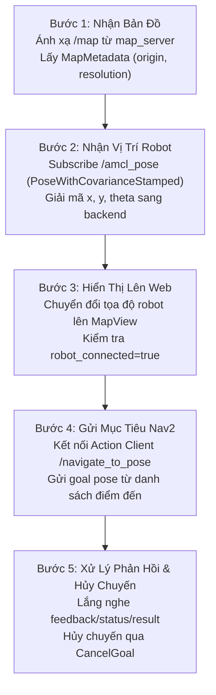

# HƯỚNG DẪN CẤU HÌNH VÀ VẬN HÀNH AIRPORT GUIDE ROBOT

Tài liệu hướng dẫn quản trị giao tiếp ROS 2 bằng file cấu hình tập trung, ánh xạ giao tiếp với Nav2/Gazebo trong VS Code Dev Container, và kế hoạch tích hợp từng bước.

---

## 1. FILE CẤU HÌNH TRUNG TÂM: `config/robot_interface.yaml`

Đường dẫn: `config/robot_interface.yaml`.

Đây là nơi **DUY NHẤT** quản lý cấu hình tên topic, service, action, QoS và chuyển đổi giữa môi trường Mô phỏng Gazebo (`sim`) và Robot thật (`real`).

### Cấu trúc chính trong file:
- `schema_version`: Phiên bản cấu hình (mặc định: `"1.0"`).
- `active_profile`: Profile đang chọn (`"sim"` cho Gazebo hoặc `"real"` cho robot vật lý).
- `connection.ros_domain_id`: Đã đồng bộ thành `0` cho cả profile `sim` và `real`, khớp hoàn toàn với `ROS_DOMAIN_ID=0` của VS Code Dev Container (`ws`).
- `frames`: `map` (frame bản đồ gốc), `odom` (frame đo quãng đường), `base_link` (thân robot).
- `topics`: Định nghĩa danh sách các topic ROS (Bản đồ `/map`, Vị trí `/amcl_pose` hoặc `/airport/pose`, Cảnh báo `/airport/alerts`, Lệnh vận tốc `/airport/cmd_vel_manual`, v.v.).
- `actions`: Action Nav2 Jazzy (`/navigate_to_pose`).
- `profiles.sim` / `profiles.real`: Các thông số ghi đè cho từng môi trường (ví dụ `use_sim_time: true` cho Gazebo và `false` cho Robot thật).

---

## 2. RÀ SOÁT ÁNH XẠ GIAO TIẾP VỚI NAV2 / GAZEBO THỰC TẾ

Dựa trên kết quả khảo sát thực tế trên môi trường ROS 2 Jazzy chạy trong Dev Container:

| Thành phần Web cần | Nguồn thực tế trong Dev Container | Topic / Action ROS thực tế | Kiểu dữ liệu ROS 2 | Đánh giá tính tương thích |
|---|---|---|---|---|
| **Bản đồ tĩnh** | `map_server` | `/map` | `nav_msgs/msg/OccupancyGrid` | Cần ánh xạ tên topic từ `/airport/map` sang `/map`. |
| **Vị trí robot** | `amcl` | `/amcl_pose` | `geometry_msgs/msg/PoseWithCovarianceStamped` | **Lệch kiểu & tên:** Cần ánh xạ tên `/amcl_pose` và chuyển đổi từ `PoseWithCovarianceStamped` sang định dạng pose nội bộ. |
| **Hành trình Nav2** | Nav2 BT Navigator | `/navigate_to_pose` | `nav2_msgs/action/NavigateToPose` | Cần ánh xạ action name sang `/navigate_to_pose` và đã cài `ros-jazzy-nav2-msgs`. |
| **Đường đi dự kiến** | Nav2 Planner | `/plan` hoặc `/airport/path` | `nav_msgs/msg/Path` | Tùy chọn, Nav2 thường phát `/plan`. |
| **Trạng thái robot** | Custom node | `/airport/state` | `airport_robot_interfaces/msg/RobotState` | Chưa có package custom; backend đang dùng fallback an toàn. |
| **Điều khiển vận tốc** | Twist Mux | `/cmd_vel` hoặc `/airport/cmd_vel_manual` | `geometry_msgs/msg/Twist` hoặc `TwistStamped` | Cần bộ phân xử an toàn trước khi kích hoạt. |

---

## 3. PHÂN TÍCH PHƯƠNG ÁN CHUYỂN ĐỔI DỮ LIỆU `/amcl_pose` SANG VỊ TRÍ BACKEND

### Vấn đề kỹ thuật:
- Backend `RosRobotAdapter` trước đây đăng ký nhận `geometry_msgs/msg/PoseStamped` từ `/airport/pose`.
- Trong khi đó, node AMCL thực tế công bố vị trí qua topic `/amcl_pose` với kiểu **`geometry_msgs/msg/PoseWithCovarianceStamped`**.
- Do kiểu message khác nhau, DDS middleware từ chối kết nối subscriber (Type Incompatibility), khiến backend **chưa nhận được dữ liệu vị trí robot**.

### Cấu trúc message `/amcl_pose`:
```text
geometry_msgs/msg/PoseWithCovarianceStamped
  std_msgs/Header header
    builtin_interfaces/Time stamp
    string frame_id                # "map"
  geometry_msgs/PoseWithCovariance pose
    geometry_msgs/Pose pose
      geometry_msgs/Point position
        float64 x
        float64 y
        float64 z
      geometry_msgs/Quaternion orientation
        float64 x
        float64 y
        float64 z
        float64 w
    float64[36] covariance        # Ma trận hiệp phương sai 6x6
```

### Phương án giải mã:
1. **Lấy tọa độ vị trí:**
   - $x = \text{msg.pose.pose.position.x}$
   - $y = \text{msg.pose.pose.position.y}$
2. **Lấy góc quay Yaw (hướng robot):**
   Chuyển đổi quaternion sang góc quay quanh trục Z (Yaw):
   $$\text{yaw} = \text{atan2}(2(w \cdot z + x \cdot y), 1 - 2(y^2 + z^2))$$
3. **Độ tin cậy định vị (Tùy chọn):**
   Kiểm tra phương sai vị trí $\text{covariance}[0]$ (trục X) và $\text{covariance}[7]$ (trục Y). Nếu phương sai vượt ngưỡng an toàn (ví dụ $> 0.5\text{ m}^2$), robot đang bị mất định vị (lost localization).
4. **Cập nhật trạng thái:**
   Gán vào từ điển pose nội bộ: `{"x": x, "y": y, "theta": yaw}` và đánh dấu thời điểm `_last_pose_time = time.time()`. Khi đó `is_connected` tự động chuyển thành `True`.

---

## 4. PHÂN BIỆT DỮ LIỆU BẢN ĐỒ THẬT VÀ SVG MINH HỌA

1. **Bản đồ SVG trên Frontend (`MapView.tsx` & `AirportMapSvg.tsx`):**
   - Hiện tại là **sơ đồ kiến trúc vector tĩnh (Mock Layout)** thể hiện các khu vực nhà ga (Cánh A, Cánh B, Hành lang).
   - Dùng hàm `rosToSvg(x, y)` để quy đổi tọa độ mét sang pixel SVG:
     $$\text{pixel\_x} = 50 + x \cdot 25, \quad \text{pixel\_y} = 450 - y \cdot 25$$
2. **Bản đồ OccupancyGrid thật từ ROS (`/map`):**
   - Là ma trận 2D dạng lưới ô chiếm dụng phát bởi `map_server` chứa thông số chướng ngại vật thực tế.
   - Backend `ros_adapter.py` đã nhận `MapMetadata` (resolution, width, height, origin).
   - **Lưu ý:** Giao diện web hiện tại chưa render lưới OccupancyGrid trực tiếp lên canvas HTML5, mà chiếu tọa độ robot thật lên sơ đồ SVG minh họa. Khi chưa có tọa độ thật từ AMCL, giao diện hiển thị nhãn cảnh báo rõ ràng: `⚠️ Chưa có dữ liệu vị trí robot`.

---

## 5. PHÂN LOẠI CÁC PACKAGE, TOPIC, SERVICE VÀ ACTION CÒN THIẾU

### Nhóm 1: Thành phần BẮT BUỘC để hoàn tất tích hợp Gazebo / Nav2
| Tên thành phần | Loại | Mục đích | Tình trạng |
|---|---|---|---|
| `ros-jazzy-nav2-msgs` | Package hệ thống | Giao tiếp Action NavigateToPose với Nav2 | Đã bổ sung vào Dockerfile backend |
| Topic `/map` | ROS Topic (`nav_msgs/OccupancyGrid`) | Đồng bộ thông số bản đồ và tọa độ gốc | Đang có trên Gazebo/Nav2 |
| Topic `/amcl_pose` | ROS Topic (`PoseWithCovarianceStamped`) | Nhận vị trí thực tế của robot trong frame `map` | Đang có trên Gazebo/Nav2, cần đổi adapter giải mã |
| Action `/navigate_to_pose` | ROS Action (`nav2_msgs/NavigateToPose`) | Gửi điểm đến dẫn đường và xử lý hủy chuyến | Đang có trên Gazebo/Nav2 |

### Nhóm 2: Thành phần CÓ THỂ BỔ SUNG SAU (Không chặn luồng cơ bản)
| Tên thành phần | Loại | Mục đích | Giải pháp tạm thời hiện tại |
|---|---|---|---|
| `airport_robot_interfaces` | Package tùy chỉnh | Đồng bộ `RobotState`, `DestinationList`, `UpsertDestination` | Backend dùng fallback tự sinh trạng thái từ Nav2 và lưu điểm đến trong `destinations.yaml`. |
| Topic `/airport/alerts` | ROS Topic (`DiagnosticArray`) | Báo cáo chẩn đoán lỗi phần cứng | Trả về mảng rỗng nếu chưa có node chẩn đoán. |
| Topic `/battery` | ROS Topic (`BatteryState`) | Hiển thị mức pin | Trả về `null` (hiển thị "Chưa có dữ liệu" trên UI). |
| Topic `/plan` | ROS Topic (`Path`) | Vẽ lộ trình di chuyển Nav2 trên bản đồ | Ẩn đường đi khi chưa có dữ liệu. |
| Service `/airport/voice/*` | ROS Service/Topic | Kích hoạt microphone trên robot | Nút microphone trên web hiển thị chế độ mô phỏng/chờ node giọng nói. |

---

## 6. KẾ HOẠCH TÍCH HỢP GAZEBO THEO THỨ TỰ TỪNG BƯỚC

Quy trình tích hợp đảm bảo an toàn tuyệt đối, tuân thủ nguyên tắc không can thiệp vào workspace `ws` của robot:



### Chi tiết các bước thực hiện:

1. **Bước 1 — Nhận thông tin Bản đồ (`/map`):**
   - Cấu hình backend subscribe topic `/map` phát từ `map_server`.
   - Kiểm tra `_map_meta` trong backend nhận đúng kích thước `width`, `height`, `resolution`, `origin`.
2. **Bước 2 — Nhận dữ liệu vị trí robot (`/amcl_pose`):**
   - Cập nhật adapter hỗ trợ kiểu `PoseWithCovarianceStamped`.
   - Đo đạc tần suất nhận dữ liệu (khoảng 5–10 Hz từ AMCL).
   - Xác nhận trường `robot_connected` trong `http://localhost:8000/api/health` chuyển sang `true`.
3. **Bước 3 — Hiển thị vị trí robot trên giao diện Web:**
   - Kiểm tra biểu tượng robot (vòng tròn xanh và mũi tên hướng nhìn) xuất hiện trên `http://localhost:5173`.
   - Di chuyển robot trong Gazebo (bằng bàn phím teleop trong Dev Container `ws`) và kiểm tra biểu tượng trên web di chuyển đồng bộ thời gian thực qua WebSocket.
4. **Bước 4 — Gửi mục tiêu dẫn đường Nav2 (`/navigate_to_pose`):**
   - Khởi tạo `ActionClient(NavigateToPose, "/navigate_to_pose")`.
   - Chọn một điểm đến trên giao diện web (hoặc qua API `/api/robot/navigate`) và gửi `goal_pose` sang Nav2.
   - Quan sát robot trong Gazebo bắt đầu xoay và di chuyển theo quy hoạch đường đi.
5. **Bước 5 — Xử lý Feedback, Kết quả và Hủy chuyến:**
   - Cập nhật tiến trình dẫn đường từ feedback của Nav2.
   - Kiểm tra nút "Hủy chuyến" trên web gửi yêu cầu hủy goal an toàn qua `cancel_goal_async()`.
   - Xác nhận robot dừng di chuyển trong Gazebo khi nhận lệnh hủy.

---

## 7. CÂU LỆNH KIỂM TRA NHANH CẤU HÌNH TRÊN UBUNTU

```bash
# Kiểm tra cấu hình đang nạp (chạy trực tiếp trong container backend)
docker compose exec backend python3 -m app.ros_config

# Kiểm tra sức khỏe hệ thống
curl -s http://localhost:8000/api/health | jq .
```
